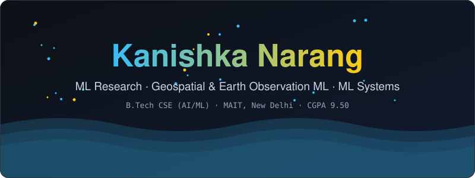
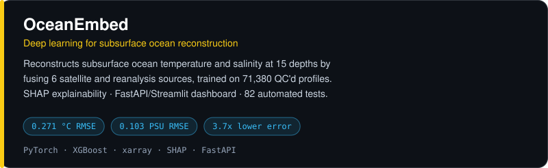
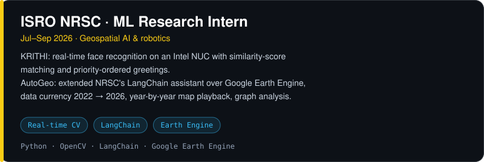
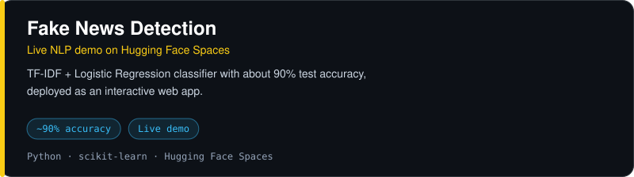
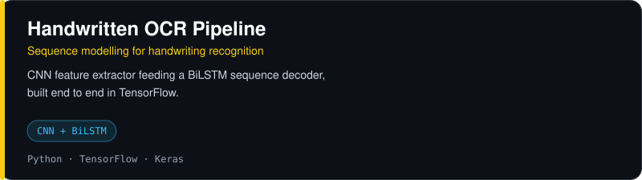

   

| 🔭 Currently working on **OceanEmbed**: ocean-ML research toward a paper submission and on **AI-powered applications** for real-world use. 🤝 Looking to collaborate on **Earth Observation ML, Climate/Ocean Modelling** and **open-source ML tooling**. 📚 Currently learning **ML systems & deployment, LLM agents (LangChain), DSA in depth**. 💬 Ask me about **Python, PyTorch, Geospatial ML, Explainable AI (SHAP)** and **Hackathons**. 🎓 B.Tech CSE (AI/ML) at **MAIT, New Delhi** · CGPA **9.50 / 10**. ✨ Fun fact: *I like taking a model from a notebook to a working, tested product.* |
| :--- |

| Role | Organisation | When |
| :--- | :--- | :--- |
| 🛰️ Research Intern, Machine Learning | ISRO, NRSC | Jul–Sep 2026 |
| 📊 Product Management Intern | Drishti Global | Jun–Jul 2026 |
| 💻 Frontend Developer Intern | Tendr | Aug–Oct 2025 |

🏆 **Winner**, Research Quest (Research Nexus MAIT) · 🥈 **Runner-Up**, Pitch-a-Thon (DTU) · ⭐ **Special Mention**, 0 to 1 Hackathon (IIIT Delhi)

### Languages
 

### ML, Deep Learning & Vision
      

### Geospatial & Data
     

### Deployment & Tools
   

 

*"Make it work, make it right, make it reproducible."*

